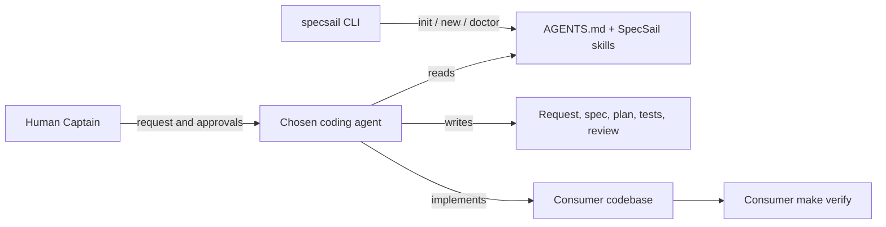

# Architecture

## System context

SpecSail is a package of instructions and project-local files plus a small Node CLI. The human developer coordinates any coding agent; the agent consumes `AGENTS.md` and the selected Markdown skill. `specsail init` copies missing templates and adds a bounded instruction block. `specsail new` scaffolds Markdown artifacts. Neither command runs an AI model.

## Module boundaries and allowed dependencies

- `bin/` dispatches to `src/cli.js`; the CLI uses only Node built-ins.
- `templates/`, `skills/`, `specs/_templates/`, and `scripts/` are installable assets, not runtime dependencies.
- Consumer stack checks belong to the adopter's `Makefile`; the SpecSail package does not choose them.
- The optional shell runner starts a configured CLI but does not control approvals or permissions.

## Critical data flows

1. `specsail init`: package assets → missing consumer files → managed instruction/config sections.
2. `specsail new`: feature kind + slug → four durable Markdown artifacts in `specs/<slug>/`.
3. Human-reviewed workflow: request → approved spec → plan → approved phase tests → implementation → independent review → PR for Captain merge.

## Cross-cutting

- All state is plain text in the consumer repository; no remote service, telemetry, secret, or model API is used.
- CLI filesystem writes are constrained to the current project and avoid overwriting unowned files.
- Node CLI supports Node.js 20+; optional shell scripts require Git and Bash.

## Invariants

- Only a human Captain approves specs/tests and merges.
- Implementation is scoped to one planned task and must pass the consumer's `make verify`.
- The npm package contains no runtime dependencies.

## Key decisions

- See `docs/adr/` for decisions as they are recorded.
